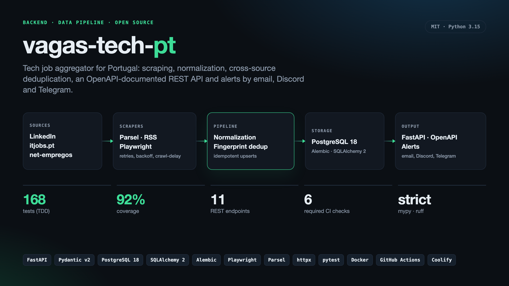

<p align="center">
  
</p>

<h1 align="center">vagas-tech-pt</h1>

<p align="center">
  <a href="https://github.com/esdrassantos06/vagas-tech-pt/actions/workflows/ci.yml"></a>
  
  
</p>



Agregador open source de vagas tech em Portugal. Recolhe vagas do LinkedIn, do
itjobs.pt e do net-empregos, normaliza-as, junta a mesma vaga publicada em sites
diferentes e serve tudo numa API REST documentada em OpenAPI. Quem quiser recebe
alertas por email, Discord ou Telegram com os seus próprios filtros.

## Como funciona

```
fontes  ->  scrapers  ->  normalização + dedup  ->  PostgreSQL  ->  API + alertas
```

1. **Scraping**: cada fonte tem um parser (RSS, HTML com Parsel, ou Playwright no
   LinkedIn) atrás de um cliente HTTP com retries, backoff exponencial,
   `Retry-After` e intervalo mínimo por site. No LinkedIn, além das pesquisas
   fixas, o scraper pesquisa as tecnologias e cidades mais seguidas nos alertas
   (só valores do vocabulário conhecido, no máximo 8 pesquisas extra).
2. **Normalização**: cidade, regime (remoto, híbrido, presencial), salário anual
   em EUR e tecnologias.
3. **Deduplicação**: por fonte, um upsert idempotente. Entre fontes, um
   fingerprint de empresa + função + cidade. `GET /jobs/{id}` mostra em
   `also_on` onde mais a vaga aparece.
4. **Alertas**: um digest por subscrição com as vagas novas que batem com os
   filtros.

Os sites mudam o HTML e os scrapers partem. Isso faz parte do desenho: os
parsers falham alto com `ParseError`, cada execução fica em `scrape_runs`
(visível em `GET /sources`), uma falha alerta o admin, e um canary semanal no
GitHub Actions corre contra os sites reais e abre uma issue quando uma fonte
muda.

## Stack

- Python 3.15, [uv](https://docs.astral.sh/uv/)
- FastAPI + Pydantic v2 (referência [Scalar](https://scalar.com) em `/docs`, Swagger em `/swagger`, OpenAPI em `/openapi.json`)
- PostgreSQL 18, SQLAlchemy 2, Alembic, psycopg 3
- httpx, Parsel, Playwright
- pytest, ruff, mypy (strict)

## Começar (local)

```bash
cp .env.example .env
docker compose up -d db
make install
make migrate
make run
```

A API fica em http://localhost:8000/docs. Para ter vagas, corre um scrape:

```bash
uv run python -m ptjobs scrape --source itjobs
```

## Comandos

```bash
make test         # pytest + cobertura (>= 80%)
make lint         # ruff check + format --check
make typecheck    # mypy strict
make openapi      # regenera docs/openapi.json

python -m ptjobs scrape                  # todas as fontes
python -m ptjobs scrape --source itjobs  # uma fonte
python -m ptjobs notify                  # envia os digests
python -m ptjobs run                     # scrape + notify
```

## API

| Método | Rota | Descrição |
|--------|------|-----------|
| GET | `/health` | Estado da aplicação e da base de dados |
| GET | `/jobs` | Vagas ativas com filtros e paginação, sem duplicados |
| GET | `/jobs/{id}` | Detalhe da vaga, com `also_on` (outras fontes) |
| GET | `/sources` | Última execução de cada scraper |
| POST | `/subscriptions` | Cria uma subscrição de alertas (opt-in) |
| GET / POST | `/subscriptions/verify` | Página de confirmação (email e Discord); só o POST confirma |
| GET / PATCH / DELETE | `/subscriptions/me` | Gere a subscrição com `Authorization: Bearer <manage_token>` |
| POST | `/subscriptions/unsubscribe` | Cancela com o manage token no body |
| GET / POST | `/subscriptions/unsubscribe/{token}` | Link de cancelamento enviado em cada alerta (one-click RFC 8058) |
| POST | `/subscriptions/recover` | Envia um novo manage token para um alerta de email (1 vez por hora) |
| POST | `/telegram/webhook` | Webhook do bot de Telegram |

Filtros de `/jobs`: `q`, `city`, `work_mode`, `seniority`, `tag`, `min_salary`, `source`,
`since`, `page`, `size`.

Exemplo de subscrição:

```json
{
  "channel": "discord",
  "target": "https://discord.com/api/webhooks/123/abc",
  "filters": { "tags": ["python"], "cities": ["lisboa"], "work_modes": ["remote"], "seniorities": ["junior", "mid"] }
}
```

A resposta traz o `manage_token` uma única vez. Guarda-o para gerir a
subscrição. Se o perderes, `POST /subscriptions/recover` com
`{"email": "..."}` envia um novo para alertas de email; no Telegram usa `/token`.
Cada alerta traz um link para cancelar sem token.

## Configuração

Só `DATABASE_URL` e `PUBLIC_BASE_URL` são obrigatórias. O resto liga canais
opcionais.

| Variável | Obrigatória | Para quê |
|----------|-------------|----------|
| `DATABASE_URL` | sim | Postgres (`postgres://`, `postgresql://` ou `postgresql+psycopg://`) |
| `PUBLIC_BASE_URL` | sim | URL público da API, usado nos links de confirmação (`https` em produção) |
| `SMTP_HOST`, `SMTP_PORT`, `SMTP_USER`, `SMTP_PASSWORD`, `SMTP_FROM` | para email | Conta de onde os emails saem |
| `TELEGRAM_BOT_TOKEN`, `TELEGRAM_BOT_USERNAME`, `TELEGRAM_WEBHOOK_SECRET` | para Telegram | O bot do serviço |
| `DISCORD_APPLICATION_ID`, `DISCORD_PUBLIC_KEY`, `DISCORD_BOT_TOKEN` | para o bot de Discord | A aplicação do Discord Developer Portal |
| `ADMIN_DISCORD_WEBHOOK` | não | Recebe alertas quando um scraper falha |

As variáveis de canal identificam o **remetente** (o serviço), não o
utilizador. Cada utilizador só indica o **destino**: o seu email, o seu webhook
do Discord, ou carrega em `/start` no bot do Telegram.

## Canais de alerta

### Discord

Com o bot, um admin do servidor escreve `/alertas` num canal e as vagas passam a
ser publicadas lá pelo próprio bot. Depois `/tags`, `/cidades`, `/modo`, `/nivel`,
`/palavras`, `/salario`, `/filtros`, `/limpar`, `/token` e `/parar` funcionam
como no Telegram (com `+`/`-`). Os comandos só aparecem a quem tem a permissão
Gerir Servidor e as respostas só são vistas por quem os usou.

Configurar o bot:

1. No [Discord Developer Portal](https://discord.com/developers/applications),
   cria a aplicação e guarda Application ID, Public Key e o token do bot.
2. Em Installation, Guild Install com `applications.commands` e `bot`, e as
   permissões Send Messages e Embed Links. Adiciona o bot ao servidor.
3. Configura `DISCORD_APPLICATION_ID`, `DISCORD_PUBLIC_KEY` e
   `DISCORD_BOT_TOKEN`, faz deploy e define o Interactions Endpoint URL como
   `https://<dominio>/discord/interactions`.
4. Regista os comandos uma vez: `python -m ptjobs discord-commands`.

Sem bot, também funciona: cria um webhook no canal (Definições do canal,
Integrações, Webhooks) e usa o URL como `target` em `POST /subscriptions`. Só
são aceites URLs `https://discord.com/api/webhooks/...`.

### Email (Resend)

1. Em [resend.com](https://resend.com), adiciona e verifica o teu domínio
   (registos MX e TXT em `send`, TXT em `resend._domainkey`).
2. Cria uma API key com `Sending access` para esse domínio.
3. Configura:

```
SMTP_HOST=smtp.resend.com
SMTP_PORT=587
SMTP_USER=resend
SMTP_PASSWORD=<resend-api-key>
SMTP_FROM=alertas@o-teu-dominio.com
```

Usa a porta 587 (STARTTLS). O `SMTP_FROM` tem de pertencer ao domínio
verificado.

### Telegram

1. No [@BotFather](https://t.me/BotFather), `/newbot`, e guarda o token.
2. Gera um secret: `openssl rand -hex 32`.
3. Configura `TELEGRAM_BOT_TOKEN`, `TELEGRAM_BOT_USERNAME` (sem `@`) e
   `TELEGRAM_WEBHOOK_SECRET`.
4. Depois do deploy, liga o webhook:

```bash
curl "https://api.telegram.org/bot<TOKEN>/setWebhook?url=https://<dominio>/telegram/webhook&secret_token=<SECRET>"
```

A subscrição devolve um `deep_link` para o bot. Ao carregar em `/start`, o chat
fica associado e verificado.

Também dá para gerir tudo só pelo bot, sem usar a API:

| Comando | Faz |
|---------|-----|
| `/start` | Ativa alertas neste chat |
| `/filtros` | Mostra os filtros |
| `/tags python react` | Define tecnologias (substitui as atuais) |
| `/tags +go -react` | Adiciona ou remove sem apagar o resto |
| `/cidades lisboa porto` | Define cidades |
| `/modo remoto hibrido presencial` | Define o regime de trabalho |
| `/nivel junior mid` | Define o nível (estagio, junior, mid, senior, lead) |
| `/palavras django` | Palavras no título ou descrição |
| `/salario 40000` | Salário anual mínimo |
| `/limpar` | Apaga todos os filtros |
| `/token` | Gera um novo token de gestão para a API |
| `/parar` | Cancela os alertas |

Um comando sem valores apaga esse filtro (por exemplo `/tags`). O `+`/`-`
funciona em `/tags`, `/cidades`, `/modo`, `/nivel` e `/palavras`.

O nível é detetado pelo título da vaga (por exemplo "Junior", "Pleno",
"Sénior", "Estágio", "Tech Lead"). Com o filtro de nível ativo, vagas sem nível
no título não são enviadas.

## Deploy (Coolify)

1. **DNS**: um registo `A` para o subdomínio da API, apontado ao servidor.
2. **Base de dados**: New Resource, PostgreSQL, imagem `postgres:18`.
3. **App**: New Resource, Public Repository
   `https://github.com/esdrassantos06/vagas-tech-pt`, branch `main`, build pack
   **Dockerfile**, porta `8000`, o teu domínio em Domains.
4. **Variáveis**: pelo menos `DATABASE_URL` e `PUBLIC_BASE_URL`. Podes colar o
   URL interno do Coolify tal como vem (`postgres://...`): a app converte-o para
   o driver psycopg.
5. **Healthcheck**: path `/health`, porta `8000`.
6. **Deploy**. O entrypoint corre `alembic upgrade head` antes do `uvicorn`.
7. **Scheduled Task**: comando `python -m ptjobs run`, cron `0 */2 * * *`. Dá
   pelo menos 1 GB de RAM à app por causa do Chromium.
8. **Deploy automático** (opcional): guarda o Deploy Webhook e um token do
   Coolify como secrets `COOLIFY_WEBHOOK_URL` e `COOLIFY_TOKEN` no repo. O CD
   chama-o a cada merge na `main`.

A imagem também é publicada em `ghcr.io/esdrassantos06/vagas-tech-pt` a cada
merge, se preferires fazer deploy a partir da imagem.

## Desenvolvimento

O projeto segue TDD: os testes vêm primeiro (RED), depois a implementação
(GREEN). A evidência de cada fase está em [docs/testing](docs/testing).

Cada PR para a `main` tem de passar 6 checks: lint, typecheck, testes contra
Postgres 18, drift do OpenAPI, bloqueio de migrations destrutivas e build da
imagem Docker. Vê [CONTRIBUTING.md](CONTRIBUTING.md).

## Licença

[MIT](LICENSE).
